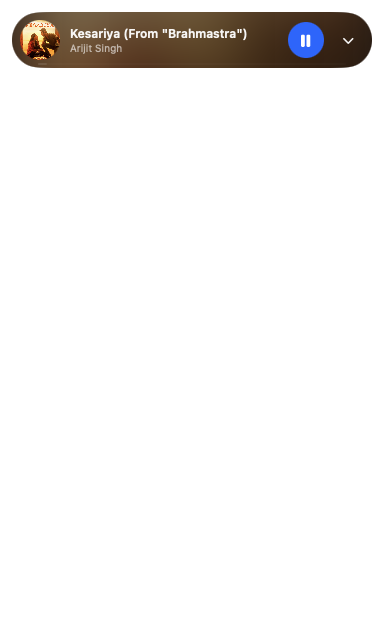

# Encore

A menu bar player for YouTube Music on macOS. It's a small glass pill under the menu bar that shows what's playing, with play/pause. Click it and it grows into a drawer with the full player, your liked songs and playlists, search, and the queue.

<p>
  
</p>
<p>
  
  
</p>

Encore is an unofficial client. It isn't affiliated with or endorsed by Google or YouTube.

## What it does

- **Play from the menu bar.** The pill shows the song and a play/pause button. Option-click the menu bar icon to play or pause without opening anything. Media keys, AirPods controls and Control Center work too.
- **Expand when you want more.** The drawer has Now Playing (artwork, scrubber, volume, Up Next), Library (Liked Songs and your playlists) and Search.
- **Sign in with the browser you already use.** Encore copies your YouTube Music session from a Chromium browser profile (Helium, Chrome, Arc, Brave, Edge, Chromium, Vivaldi). There's no Google sign-in screen inside the app.
- **Lower the music while you dictate.** When a dictation app such as [Hex](https://github.com/kitlangton/Hex) opens the microphone, Encore fades the music down, then brings it back when you stop talking. You choose which apps trigger this, and how quiet the music gets, in Settings.
- **Several accounts.** Add one Encore account per browser profile and switch between them from the account menu.

## Requirements

- macOS 26 or later (Encore uses Liquid Glass)
- Xcode 26 or later to build

## Build

```sh
./build.sh            # builds build/Encore.app
./build.sh --install  # also copies it to /Applications
open build/Encore.app
```

`build.sh` uses `xcrun swift` so it builds with Xcode's toolchain even if another Swift (for example from swiftly) comes first on your `PATH`.

## How it works

YouTube Music's own web player runs in a hidden `WKWebView`, which handles your account, Premium and streaming. An injected script (`Sources/Encore/Bridge.swift`) reports playback state to Swift and exposes commands. The SwiftUI interface draws everything you see. Search, the library and playlists use the InnerTube JSON API from inside the page, signed with the page's own session.

### Sign-in

When you connect an account, Encore:

1. finds browser profiles on your Mac that have a YouTube session,
2. asks macOS for that browser's cookie encryption key (you'll see a keychain prompt),
3. decrypts only the `youtube.com` and `google.com` cookies from a copy of the profile's cookie database, and
4. stores them in that Encore account's own isolated `WKWebsiteDataStore`.

Nothing leaves your Mac. Google refreshes part of the session from time to time, so a copied session can lapse while your browser stays signed in. When that happens Encore imports again from the same profile. Choose **Always Allow** at the keychain prompt so this happens silently.

### Dictation ducking

Encore checks the system's audio process list (`kAudioHardwarePropertyProcessObjectList`) four times a second to see which apps have their microphone input running. When one of your trigger apps does, Encore scales the player's volume down with a short fade. It holds for 0.6 seconds after the mic closes, so pauses between phrases don't pump the music, then fades back. Your YouTube Music volume setting is never changed.

## License

MIT. See [LICENSE](LICENSE).
