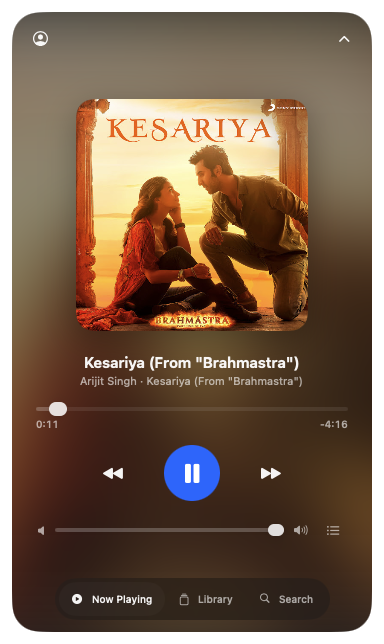
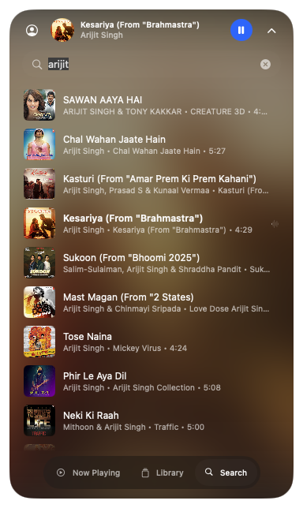

# Encore

A menu bar player for YouTube Music on macOS. It's a small glass pill under the menu bar that shows what's playing, with play/pause. Click it and it grows into a drawer with the full player, your liked songs and playlists, search, and the queue.

<p>
  
</p>
<p>
  
  
</p>

Encore is an unofficial client. It isn't affiliated with or endorsed by Google or YouTube.

## What it does

- **Play from the menu bar.** The pill shows the song and a play/pause button. Option-click the menu bar icon to play or pause without opening anything. Media keys, AirPods controls and Control Center work too.
- **Expand when you want more.** The drawer has Now Playing (artwork, scrubber, volume, Up Next), Library (Liked Songs and your playlists) and Search.
- **Sign in once, inside the panel.** Google's sign-in page opens in the drawer itself. Approve on your phone or use your password, and Encore stays signed in.
- **Lower the music while you dictate.** When a dictation app such as [Hex](https://github.com/kitlangton/Hex) opens the microphone, Encore fades the music down, then brings it back when you stop talking. You choose which apps trigger this, and how quiet the music gets, in Settings.
- **Several accounts.** Each Encore account keeps its own Google sign-in. Switch between them from the account menu.

## Requirements

- macOS 26 or later (Encore uses Liquid Glass)
- Xcode 26 or later to build

## Build

```sh
./build.sh            # builds build/Encore.app
./build.sh --install  # also copies it to /Applications
open build/Encore.app
```

`build.sh` uses `xcrun swift` so it builds with Xcode's toolchain even if another Swift (for example from swiftly) comes first on your `PATH`.

## How it works

YouTube Music's own web player runs in a hidden `WKWebView`, which handles your account, Premium and streaming. An injected script (`Sources/Encore/Bridge.swift`) reports playback state to Swift and exposes commands. The SwiftUI interface draws everything you see. Search, the library and playlists use the InnerTube JSON API from inside the page, signed with the page's own session.

### Sign-in

**Sign In with Google** shows Google's own sign-in page inside the drawer. It writes into that Encore account's isolated `WKWebsiteDataStore`, the same one the player uses, so the player is signed in as soon as Google returns to YouTube Music. Google keeps that session fresh by itself.

macOS only lets apps that Apple approves as web browsers use passkeys for google.com, so Encore hides passkey support from the page. Google then offers its other methods, such as a prompt on your phone or your password.

### Dictation ducking

Encore checks the system's audio process list (`kAudioHardwarePropertyProcessObjectList`) four times a second to see which apps have their microphone input running. When one of your trigger apps does, Encore scales the player's volume down with a short fade. It holds for 0.6 seconds after the mic closes, so pauses between phrases don't pump the music, then fades back. Your YouTube Music volume setting is never changed.

## License

MIT. See [LICENSE](LICENSE).
